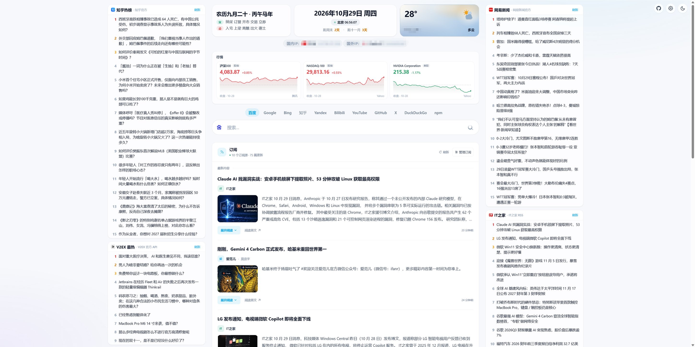

# lite-nav

自托管的个人起始页:今日信息、天气、行情、热榜与 RSS 订阅。
前端零构建(原生 ES Modules + Canvas),后端只做「抓取 + 缓存 + 多源兜底」;首屏静态资源 gzip 约 86 KB。

项目地址:[github.com/PazzIFirst/lite_nav](https://github.com/PazzIFirst/lite_nav)



---

## 功能

### 今日

- 公历 / 农历 / 老黄历(宜忌),全部按**北京时间**计算,跨日与切回标签页会重新对齐
- 距周末、距下个月、距下一个节日
- 多国节假日(默认预热常用国家,其余按需拉取)

### 天气

- 自动识别访客 IP 定位,另可自定义两个城市
- 国内 446 个城市优先走**中国天气网**(数据源为国家气象局),境外走 Open-Meteo;都带备用源兜底
- 28 种天气各有独立的 Canvas 动效与自绘 SVG 图标(晴 / 云 / 雨 / 雪 / 冻雨 / 雾 / 沙尘 / 雷),图标与动效一一对应

### 行情

三张可配置的卡片,点卡片任意位置换标的。

- **选标的**:货币 13 组、股指 27 个(分「中国 / 港股 / 美股 / 亚太 / 欧洲 / 其他」),A股 / 港股 / 美股直接输代码,后端解析成 `secid` 并带回规范名
- **图表**:只画一个交易日——盘中按完整交易时段绘制当天分时(未发生的时段留白,午休压缩),收盘显示最近一个交易日
- **可读性**:点数抽稀到像素级,再做 7 点滑动平均,只保留当天的大形状;报价与涨跌幅始终用真实值
- **配色**:红涨绿跌(默认)/ 绿涨红跌,在「页面设置」里切
- **刷新**:30 秒轮询,只重画盘中卡片;收盘卡每 10 分钟兜底刷一次

### 热榜

- 22 个源任选,四个槽位(左上 / 左下 / 右上 / 右下)各自下拉选择,可留空
- 服务端每 5 分钟刷新并缓存,前端 5 分钟轮询
- 侧栏高于视口时跟随页面滚动,到下沿停靠,反向滚动立即回移

### 订阅(RSS)

- **49 个预设源**分 7 组:中文科技 / 社区 / 海外科技 / 中文新闻 / 国际新闻 / 开发与工程 / AI 与开源;也可贴任意 RSS / Atom 地址(添加时先试抓一次)
- **跨源交错**:每个源内部保持时间顺序,跨源交错后最多连续两篇来自同一源——一条高频源不会把整列刷满
- **图文阅读**:列表自带缩略图与摘要,可「展开阅读」在页内读正文,或点原文跳转
- **续读**:接近底部自动加载下一批,角标显示还剩多少篇
- 单源缓存 10 分钟,15 分钟自动刷新,可手动刷新

### 搜索

- 多引擎切换(百度 / Google / Bing / 知乎 / Yandex / Bilibili / YouTube / GitHub / X / DuckDuckGo / npm)
- 本地搜索历史;输入联想可在设置里关掉

### 页面设置

右上角齿轮,三段设置共用同一套「保存 / 取消 / 恢复默认 / 遮罩 / Esc」语义:

1. 热榜槽位
2. 搜索词联想开关
3. 行情涨跌配色

另有深色 / 浅色主题切换,偏好只存在本机。

---

## 架构

```
浏览器(静态前端,零构建)
   │  /api/*
   ▼
Nginx / OpenResty(静态站点 + 反代,可选 Cloudflare 橙云)
   │  127.0.0.1:3000
   ▼
Express(Node 20)─┬─ 定时任务:热榜 5min / 节假日每日 03:00
                 ├─ 抓取层:超时、限体积、主备链、单源冷却
                 └─ Redis:cache:<key>(热数据,带 TTL)+ lastgood:<key>(兜底,长 TTL)
```

**三个刻意的设计:**

- **前端零构建**。没有打包器、没有框架、没有 node_modules,改一行 CSS 刷新即生效。代价是不能用 JSX/TS,换来的是一年后再打开还能看懂。
- **Redis 双键**。`cache:` 是热数据(TTL 到期即失效),`lastgood:` 是最后一次成功的结果。上游挂了仍然有内容可显示,只是会带上「不是最新的」标记。
- **按市场选源,而不是排队重试**。腾讯、Yahoo、新浪覆盖的市场不一样,排队等超时只会让每次请求都慢 6 秒。所以按标的类型直接选主源,失败才换下一个。

---

## 快速开始(本地)

需要 Node 20+ 与 Redis。

```bash
# 1. Redis
docker run -d --name lite-nav-redis -p 6379:6379 redis:7-alpine

# 2. 后端
cd backend
npm ci
PORT=3000 REDIS_HOST=127.0.0.1 TZ=Asia/Shanghai node src/server.js

# 3. 前端(另开一个终端)
python3 -m http.server 8099 --directory frontend
```

打开 `http://localhost:8099` 只能看到布局:前端要求 `/api` 与页面同源,`http.server` 不做转发。
要看真实数据,把 `frontend/` 交给 Nginx 托管、按 `deploy/openresty-api-snippet.conf.example` 反代 `/api`,或者直接按下一节的 Docker 方式部署。

---

## 部署

### Docker Compose(推荐)

```bash
cp backend/docker-compose.yml.example backend/docker-compose.yml
# 改 REDIS_HOST / REDIS_PASSWORD,再起:
docker compose -f backend/docker-compose.yml up -d
docker compose -f backend/docker-compose.yml logs -f    # 看到 [server] listening 即成功
```

模板默认拉取 Docker Hub 上的预构建镜像(`pazzifirst/lite-nav-backend:latest`);要改源码就注释掉 `image:`,改用 `build: .`。

镜像本身只绑 `127.0.0.1:3000`,对外一律走反代。

### 1Panel

```bash
git clone <repo> && cd lite-nav
cp backend/docker-compose.yml.example backend/docker-compose.yml
# 1Panel 的 Redis 容器名通常形如 1Panel-redis-XXXX,网络是 1panel-network,按实际情况改

# 在 1Panel 里创建「静态」网站 + 申请 Let's Encrypt 证书后:
sudo bash deploy/deploy-after-1panel-site.sh nav.example.com
```

脚本会自动找 OpenResty 容器名并注入反代配置;识别不到时可显式传第二个参数。

### 普通 Nginx / Caddy

把 `frontend/` 整个目录(含 `css/js/flags/robots.txt/sitemap.xml`)放到网站根,再追加反代片段:

```nginx
include /path/to/deploy/openresty-api-snippet.conf.example;
```

### Cloudflare 橙云(可选)

源站会暴露真实 IP,橙云代理后必须让 Nginx 还原访客 IP,否则 `/api/ip` 显示的是 CF 节点,限流也会按 CF 节点算。

```bash
# 1. CF 后台 DNS 加 A 记录,代理状态选「已代理」;SSL/TLS 模式选「完全(严格)」
#    切勿选「灵活」:CF→源站走明文,源站 443 有证书时会无限重定向
# 2. 站点配置 include 真实 IP 片段(只信任 CF 网段的 CF-Connecting-IP)
include /path/to/deploy/cloudflare-realip.conf.example;
# 3. 用 systemd timer 每天刷新 CF 网段白名单(见 deploy/cf-realip-update.*)
```

`deploy/nginx-default-deny.conf.example` 用于切断「源站 IP → 域名」的自动关联(扫描器靠证书 SAN 建索引),按需启用。

---

## 配置

### 后端环境变量

| 变量 | 默认 | 说明 |
|---|---|---|
| `PORT` | `3000` | 监听端口 |
| `HOST` | `0.0.0.0` | 监听地址 |
| `TZ` | 系统时区 | **建议显式设 `Asia/Shanghai`**,定时任务按它跑 |
| `REDIS_HOST` | `127.0.0.1` | Redis 主机 |
| `REDIS_PORT` | `6379` | Redis 端口 |
| `REDIS_PASSWORD` | 空 | Redis 密码 |
| `TRUST_PROXY` | 空 | 信任的反代跳数;仅本机反代用 `1`,**不要用 `true`** |
| `CORS_ORIGIN` | 空 | 需要跨域时白名单,同源部署不用填 |
| `RATE_LIMIT_PER_MIN` | `120` | `/api/*` 每分钟每 IP 上限 |
| `REFRESH_LIMIT_PER_MIN` | `5` | 手动刷新接口的独立限流 |
| `REFRESH_TOKEN` | 空 | 手动刷新接口的 token;不设则接口关闭 |
| `FETCH_MAX_BODY_BYTES` | `2 MiB` | 第三方响应体上限 |
| `DYNAMIC_LASTGOOD_TTL_SEC` | 30 天 | 用户输入类数据(自定义 RSS / 任意证券)的兜底缓存时长 |
| `PACKED_HOLIDAY_DIR` | 空 | 打包节假日数据目录 |

`TRUST_PROXY` 说明:它决定 `X-Forwarded-For` 里取第几跳当访客 IP。填 `true` 等同于无条件信任客户端可伪造的头,限流与 `/api/ip` 都会被绕过。

### 前端本地存储(浏览器内,无需配置)

| key | 内容 |
|---|---|
| `theme` | 深色 / 浅色 |
| `wxCity1` / `wxCity2` | 自定义天气城市 |
| `hotSlots` | 四个热榜槽位 |
| `searchHistory` | 搜索历史 |
| `nav.fin.slots` / `nav.fin.color` | 三张行情卡与涨跌配色 |
| `nav.rss.feeds` | 勾选的订阅源 |
| `nav.search.suggestions` | 搜索词联想开关 |

---

## API

| 方法 | 路径 | 说明 |
|---|---|---|
| GET | `/api/health` | 健康检查 + 缓存状态 |
| GET | `/api/today` | 公历 / 农历 / 黄历 / 倒计时 |
| GET | `/api/weather?city=` 或 `?lat=&lon=` | 天气 |
| GET | `/api/ip` | 访客国内 / 国外出口 IP |
| GET | `/api/hot/catalog` | 热榜源清单 |
| GET | `/api/hot/:id` | 单个热榜 |
| POST | `/api/hot/:id/refresh` | 强制刷新(需 `x-refresh-token`) |
| GET | `/api/holidays/countries` | 支持的节假日国家 |
| GET | `/api/holidays?country=&year=` | 节假日 |
| GET | `/api/intraday?secid=` | 当日分时(行情卡用) |
| GET | `/api/symbol?market=&code=` | 证券代码解析 |
| POST | `/api/rss` | 批量抓取订阅,`{ urls: [...] }`,返回混排后的条目 |
| GET | `/api/rss/feed?url=` | 单个订阅源校验 |
| GET | `/api/favicon?domain=` | favicon 代理 |
| GET | `/api/suggest?q=` | 搜索联想 |

统一响应形态:`{ data, source, source_label, fetched_at }`;错误为 `{ error }` + 4xx/5xx。

---

## 数据源与缓存

| 数据 | 主 | 备 | 缓存 |
|---|---|---|---|
| 农历 / 黄历 | `lunar-javascript`(纯算法) | — | 进程内 |
| 节假日 | `date-holidays` + 打包数据 | 多源合并 | 7 天 |
| 天气(按城市名) | 中国天气网 | Open-Meteo → wttr.in | 30 分钟 |
| 天气(按经纬度) | Open-Meteo | wttr.in | 30 分钟 |
| 热榜 | 各站官方接口 | 上轮缓存 | 5 分钟 |
| 行情分时(A股/港股) | 腾讯 | 东财 | 盘中 30s / 盘后 5min |
| 行情分时(美股/指数/外汇) | Yahoo | 腾讯 / 东财 / 新浪 | 同上 |
| 订阅源 | 各自 RSS / Atom | 上轮缓存 | 10 分钟 |
| favicon | 站点自身 | 上轮缓存 | 进程内 LRU |

**关于东财**:它的接口字段最全,但对突发请求会直接断 TLS(实测连发十几次就被封),所以只当备源,失败后冷却 10 分钟。

**关于动态 key**:用户输入的地址(自定义 RSS、任意证券代码)产生的缓存走 `lastgood:` 且带 TTL,避免无限增长。

---

## 目录结构

```
lite-nav/
├── backend/
│   ├── Dockerfile
│   ├── docker-compose.yml.example
│   └── src/
│       ├── server.js            # 路由 + 错误处理 + 限流
│       ├── scheduler.js         # 定时任务(热榜/节假日)
│       ├── fetcher.js           # 带超时与体积上限的抓取
│       ├── redis.js             # cache:/lastgood: 双键读写
│       ├── rss-network.js       # RSS 出网策略(IP 分类、逐跳校验)
│       ├── safe.js / validators.js
│       └── sources/             # 每个数据源一个模块
│           ├── chart.js         # 行情:分时抓取 / 交易时段 / 代码解析
│           ├── rss.js           # 订阅抓取与解析
│           ├── rss-parser.js
│           ├── hot.js weather.js holiday.js today.js ip.js suggest.js
│           └── data/ i18n/
├── frontend/                    # 纯静态,零构建
│   ├── index.html
│   ├── css/main.css             # design tokens + 全部样式
│   └── js/
│       ├── main.js              # 初始化与轮询调度
│       ├── finance.js finance-chart.js
│       ├── rss.js rss-content.js rss-flow.js rss-presets.js
│       ├── hot.js sidebar-scroll.js
│       ├── today.js ip-weather.js search.js
│       ├── weather-fx.js weather-icons.js
│       └── api.js
├── scripts/                     # 检查脚本(见下)
├── deploy/                      # Nginx / Cloudflare 部署片段
├── docs/                        # 设计文档与截图
└── .github/workflows/           # CI(检查 + 镜像发布)
```

---

## 质量控制

本地跑检查(CI 用同一条命令):

```bash
node scripts/static-checks.mjs                       # 语法 + import 解析 + DOM id 契约
node scripts/rss-content-checks.mjs                  # RSS 正文白名单重建
node scripts/rss-flow-checks.mjs                     # 跨源交错规则
node scripts/rss-security-checks.mjs                 # SSRF / 内网地址拦截

# 下面几个用 vm.SourceTextModule 模拟模块加载,必须带这个 flag
node --experimental-vm-modules scripts/review-core-checks.mjs
node --experimental-vm-modules scripts/review-data-checks.mjs
node --experimental-vm-modules scripts/intraday-session-checks.mjs
node scripts/finance-chart-checks.mjs

# 浏览器回归(需要 playwright + chromium)
node scripts/frontend-state-checks.mjs
node scripts/finance-chart-browser-checks.mjs
node scripts/hot-scroll-checks.mjs
```

CI(`.github/workflows/ci.yml`)会起一个 Redis、跑上述全部检查、再拉起后端跑冒烟测试。冒烟只断言不依赖第三方外网的端点——热榜和行情要打外网,放进 CI 只会随机变红。

---

## 常见问题

**Q: 为什么前端不用框架?**

A: 这个站 90% 的复杂度在数据和缓存策略上,不在 UI。零构建让"改一行刷新就行"成立,也避免了几年后回来还要处理工具链。

**Q: 为什么行情/热榜要服务端代理?**

A: 三个原因:浏览器直连会被 CORS 和反爬挡住;服务端能缓存,避免每个访客都打一次第三方;失败时还能拿 `lastgood` 兜底。

**Q: 行情卡为什么只能看一个交易日?**

A: 卡片宽度只有 200px 左右,60 根日 K 在这个尺寸下只能看个大概趋势;当天分时反而能把"今天怎么走的"说清楚。

**Q: 订阅为什么不是纯时间排序?**

A: 纯时间排序会让高频源(比如 IT之家)占满整列。现在的规则是每个源内部保序、跨源交错、最多连续两篇同源,既保留时间感,又保证每个源都露脸。

**Q: 上游全挂了会怎样?**

A: 有 `lastgood` 的内容会照样显示(标注非最新),没有的会显示空状态。前端不会因为一个源失败就整块白屏。

**Q: 怎么加一个新的热榜 / 订阅源?**

A: 热榜加在 `backend/src/sources/hot.js` 的源表;订阅预设加在 `frontend/js/rss-presets.js`(用户也可以直接贴地址,不必进预设)。

---

## 许可

见 [LICENSE](LICENSE)。
